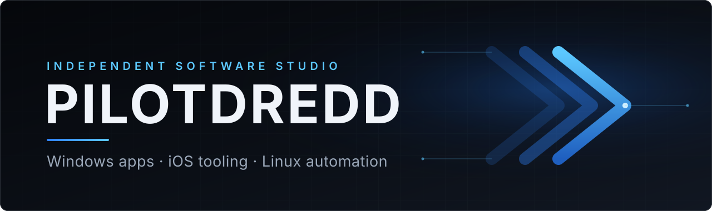

  

  <b>PILOTDREDD</b> — независимая студия, которая делает бесплатные и аккуратные программы для Windows. 
  Без рекламы, подписок и телеметрии. Открытый исходный код. 
  Independent software studio building free, clean Windows tools — no ads, no subscriptions, no telemetry. Open source.

  <a href="#ipa-pilotdredd">IPA PILOTDREDD</a> ·
  <a href="#dredd-cleaner">Dredd Cleaner</a> ·
  <a href="#dredd-menu">Dredd Menu</a> ·
  <a href="#другие-проекты">Другие проекты</a> ·
  <a href="#стек">Стек</a> ·
  <a href="#контакты">Контакты</a>

## IPA PILOTDREDD

WINDOWS 10/11 · POWERSHELL 5.1 + WPF · PORTABLE · MIT

Библиотека покупок App Store на Windows. Все приложения вашего Apple ID — с иконками, версиями и честными статусами. Подключите iPhone по кабелю или Wi‑Fi: программа покажет, чего на нём нет и что пора обновить, и поставит нужное одной кнопкой.

Your own Apple ID purchase history as a Windows library: download any available IPA version and install it on iPhone/iPad over cable or Wi‑Fi.

**[Скачать](https://github.com/PiloTDredd/IPA_PILOTDREDD/releases/latest)** · [Исходный код](https://github.com/PiloTDredd/IPA_PILOTDREDD) · [Безопасность](https://github.com/PiloTDredd/IPA_PILOTDREDD/blob/main/docs/SECURITY.md) · [Изменения](https://github.com/PiloTDredd/IPA_PILOTDREDD/blob/main/CHANGELOG.md)

Основан на <a href="https://github.com/kda2495/IPA_Downloader">IPA Downloader</a> (kda2495), использует ipatool-cpp и libimobiledevice. Работает только с покупками вашего Apple ID.

## Dredd Cleaner

WINDOWS 10/11 · C# · .NET 8 · WPF · PORTABLE · MIT

Клинер в родном стиле Windows 11. Сначала анализ, потом удаление — видно каждую категорию и каждый файл. Без «эвристик» и чистки реестра. Внутри также автозагрузка и удаление программ.

A careful Windows 10/11 cleaner: analyze first, then delete exactly what was shown. Startup manager and uninstaller included.

**[Скачать](https://github.com/PiloTDredd/DreddCleaner/releases/latest)** · [Исходный код](https://github.com/PiloTDredd/DreddCleaner)

## Dredd Menu

WINDOWS 10/11 · C# · .NET 8 · WPF · PORTABLE · MIT

Настройка правого клика Windows. Включайте и выключайте пункты, добавляйте свои, смотрите предпросмотр до применения. Перед каждым изменением — бэкап, откат одной кнопкой. Поддерживает новое меню Windows 11.

Windows context menu tuner: toggle items, add your own, preview before applying, roll back with one click.

**[Скачать](https://github.com/PiloTDredd/DreddMenu/releases/latest)** · [Исходный код](https://github.com/PiloTDredd/DreddMenu)

## Другие проекты

| Проект | Что делает | Стек |
|---|---|---|
| [site-guard](https://github.com/PiloTDredd/site-guard) | Ночные бэкапы сайта и мониторинг (доступность, SSL, диск) с уведомлениями в Telegram. Без внешних сервисов. | Python 3 · Bash · systemd |
| [geshtalt-web](https://github.com/PiloTDredd/geshtalt-web) | Шаблон одностраничного сайта. | HTML · CSS |

## Стек

| Направление | Технологии |
|---|---|
| Desktop | C# · .NET 8 · WPF · [WPF‑UI](https://github.com/lepoco/wpfui) |
| Автоматизация | PowerShell 5.1 · Bash |
| iOS‑инструменты | ipatool‑cpp · libimobiledevice |
| Серверы | Linux · Python 3 · systemd · Telegram Bot API |
| CI / релизы | GitHub Actions · GitHub Releases |

## Принципы

- **Бесплатно** — без рекламы, подписок и «PRO‑версий».
- **Прозрачно** — открытый исходный код, без телеметрии.
- **Обратимо** — сначала показать, потом менять; бэкапы и откат там, где программа что‑то меняет в системе.
- **Портативно** — один exe или архив, без установки.

## Контакты

- Telegram — [@pilotdredd](https://t.me/pilotdredd)
- Вопросы и ошибки — Issues в репозитории нужной программы
- Поддержать проекты — [CloudTips](https://pay.cloudtips.ru/p/129557e1)

© PILOTDREDD · Все программы бесплатные

